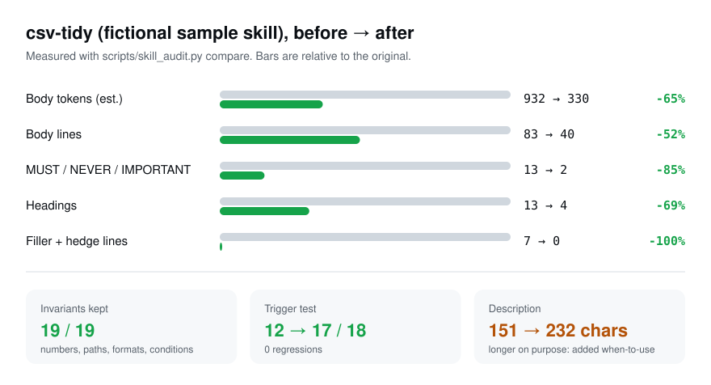
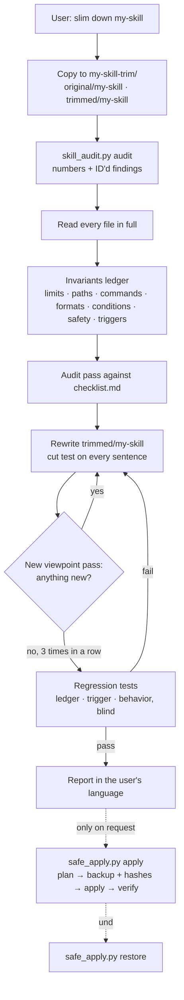

<p align="center">
  <picture>
    <source media="(prefers-color-scheme: dark)" srcset="brand/icon-dark.svg">
    
  </picture>
</p>

<p align="center">
  <picture>
    <source media="(prefers-color-scheme: dark)" srcset="brand/wordmark-white.svg">
    
  </picture>
</p>

<p align="center"><b>Put your SKILL.md on a diet — without losing what it does.</b><br>
An Agent Skill that audits a skill, trims a copy, and proves the shorter one still behaves the same.<br>
Python standard library · No API keys · Original never touched without a backup</p>

<p align="center">
  <a href="#quick-start"><b>Quick start</b></a> ·
  <a href="#real-world-example-anthropics-skill-creator">Real-world example</a> ·
  <a href="#what-it-checks">Checks</a> ·
  <a href="#scripts">Scripts</a> ·
  <a href="#日本語">日本語</a>
</p>

<p align="center">
  <a href="https://github.com/kajisho5/skill-diet/actions/workflows/ci.yml"></a>
  <a href="https://github.com/kajisho5/skill-diet/releases/latest"></a>
  
  
  <a href="LICENSE"></a>
</p>

<p align="center">
  <picture>
    <source media="(prefers-color-scheme: dark)" srcset="docs/demo-dark.svg">
    
  </picture>
</p>

<p align="center"><sub>A deliberately bloated, fictional skill, trimmed end to end by an agent running skill-diet. Every number comes from the files in <a href="examples/csv-tidy/"><code>examples/csv-tidy/</code></a>; the picture is rebuilt from them by <code>python3 demos/build.py</code>.</sub></p>

`skill-diet` is an [Agent Skill](https://agentskills.io) for Claude Code, the Claude apps and any agent that reads `SKILL.md`. Ask it to slim down a skill and it does five things in order: **audits** the skill against the published rules with ID-numbered, line-cited findings; **lists what must not be lost** before it changes a word; **trims a copy** until three review passes in a row find nothing new; **tests** that the copy still triggers and still does the job; and **applies** the result only when you say so, after a hash-verified backup you can undo with one command.

---

**Contents**
[Why](#why) · [Quick start](#quick-start) · [Real-world example](#real-world-example-anthropics-skill-creator) · [Sample walk-through](#example-a-bloated-skill-before-and-after) · [How it works](#how-it-works) · [Design principles](#design-principles) · [What it checks](#what-it-checks) · [Scripts](#scripts) · [Regression testing](#regression-testing) · [When the sources disagree](#when-the-sources-disagree) · [Where it runs](#where-it-runs) · [FAQ](#faq) · [How it compares](#how-it-compares) · [Limits](#limits) · [Development](#development) · [日本語](#日本語)

---

## Why

Every installed skill costs context. Its description sits in the system prompt on every turn, for every skill you have installed, and its body is loaded whenever it triggers — and in Claude Code it then stays in the conversation, re-attached after compaction up to the first 5,000 tokens of each skill ([docs](https://code.claude.com/docs/en/skills)). Skills tend to grow the same way: an introduction explaining what a CSV file is, a "when to use this skill" section that is only read *after* the skill was chosen, the same rule written three times, `MUST` on every line, a closing summary of everything above it.

Shortening by hand is where it goes wrong. A trim that looks harmless can delete the one condition that mattered ("files exported before March 2024 use MM/DD"), strip the trigger words that made the skill activate, or rename it and break `/skill-name`. Linters can point at long files; they cannot tell you whether the shorter version still works.

skill-diet turns trimming into a checked process:

- **Rules with sources.** Every finding has an ID that points to the [Agent Skills spec](https://agentskills.io/specification), Anthropic's [skill authoring best practices](https://platform.claude.com/docs/en/agents-and-tools/agent-skills/best-practices) or the [Claude Code skills docs](https://code.claude.com/docs/en/skills), plus the file and line it is about.
- **Invariants before edits.** Numbers, paths, commands, formats, conditions, safety rules and trigger words are listed *first*, and every one must have a location in the trimmed copy at the end.
- **A cut test, not a word count.** "If this sentence is gone, would a capable model do anything differently?" No → cut. Unsure → keep and list it.
- **Behavior, not just text.** The original and the trimmed copy are run on the same tasks by fresh agents and judged blind; the description is run through a trigger test.
- **Fail-closed apply.** Nothing replaces your skill until you ask, and then only after a backup whose SHA-256 hashes are checked, with a one-line undo.

## Quick start

**Claude Code**

```bash
git clone https://github.com/kajisho5/skill-diet ~/.claude/skills/skill-diet
```

**Claude apps (claude.ai, desktop, mobile)**: download `skill-diet.skill` from the [latest release](https://github.com/kajisho5/skill-diet/releases/latest), open it in a chat and press **Save skill** (the button appears when your account or organization allows adding skills).

**Other agents that read `SKILL.md`** (Codex, Cursor, …): copy the folder into that agent's skills directory. Not tested by this repository yet; see [Where it runs](#where-it-runs).

Then ask:

> "Audit my `pdf-report` skill and slim it down."
>
> 「このスキル長いから監査して短くして」

The agent copies the skill into `pdf-report-trim/original/` and `pdf-report-trim/trimmed/`, runs the audit script, reads every file, writes the invariants ledger, trims the copy, re-audits from new angles, runs the regression tests and reports back in your language. Your skill is not touched. If you then say "apply it", it shows the plan, and on your confirmation backs up, applies and verifies.

Only want the review? Ask for an audit: it stops after the findings.

The scripts also work on their own, from any shell:

```bash
D=~/.claude/skills/skill-diet/scripts
python3 $D/skill_audit.py audit path/to/my-skill                 # numbers + ID'd findings
python3 $D/skill_audit.py audit path/to/my-skill --json          # the same, machine-readable
python3 $D/skill_audit.py compare old/my-skill new/my-skill      # before/after table
python3 $D/safe_apply.py apply my-skill-trim path/to/my-skill        # plan only
python3 $D/safe_apply.py apply my-skill-trim path/to/my-skill --yes  # backup + apply + verify
```

## Real-world example: Anthropic's skill-creator

The chart above is a sample made to be bloated. Here is a real skill: **skill-creator** from [anthropics/skills](https://github.com/anthropics/skills/tree/dbd4588f9e1033efb41dad4bef2f7947c8993d44/skills/skill-creator) (commit `dbd4588`, Apache-2.0), chosen because its body is over the spec's ~5,000-token recommendation. An agent ran the full skill-diet workflow on a copy; the result was then checked independently. Full evidence in [`examples/skill-creator/`](examples/skill-creator/). Not affiliated with Anthropic and not proposed upstream.

| | before | after |
|---|---|---|
| SKILL.md body | 482 lines, ~8,225 tokens | 264 lines, ~4,414 tokens (**−46%**) |
| Fits in the 5,000 tokens kept after compaction | no: everything from ~line 313 on could be dropped | yes |
| Description | 319 chars | unchanged, on purpose |
| Scripts, viewer, agents, schemas, license | | byte-identical (SHA-256) |
| Invariants (commands, paths, flags, field names, numbers, rules) | 74 listed | 74 / 74 kept |
| Trigger test (20 queries) | 17 / 20 | 17 / 20 |
| Behavior test (3 tasks, fictional data) | all assertions pass | all assertions pass |

What went: pep talk ("Cool? Cool.", "billions a year in economic value"), filler and hedges, the closing recap, the same viewer rule stated three times, decorative bold. What moved: the ~1,000-token description-optimization section, now read only when the user takes that step. What stayed on purpose: the description, every command and field name, both all-caps rules, and the advice that shapes the skills users write. One visible change: the original contradicts itself on test-case directory names, and the trimmed copy keeps only the explicit rule.

The blind comparison went 2–1 to the original in the first round; comparing the original with itself showed the same variation, and the trimmed copy won later pairs on both disputed tasks ([details](examples/skill-creator/blind-results.md)). How much a skill shrinks depends on the skill: one that is already lean gets "already lean", not a forced cut.

## Example: a bloated skill, before and after

[`examples/csv-tidy/`](examples/csv-tidy/) holds a fictional CSV-cleaning skill written to be bloated on purpose, and what an agent running skill-diet made of it. Nothing was edited by hand afterwards.

<table>
<tr><th>Before (<a href="examples/csv-tidy/SKILL.before.md">full file</a>, 83 lines)</th><th>After (<a href="examples/csv-tidy/SKILL.after.md">full file</a>, 40 lines)</th></tr>
<tr><td>

```markdown
description: I can help you clean CSV files.
  First read the file, then normalise the
  headers, then fix the dates, then remove
  duplicates and finally write tidy.csv.

## Introduction
CSV (Comma-Separated Values) is a very common
file format ... It is important to note that ...

## When to use this skill
Use this skill when the user has a CSV file ...
You should probably use this skill whenever a
CSV file is involved, if possible.

## IMPORTANT RULES
- You MUST ALWAYS keep the original file.
  NEVER overwrite the input file. ALWAYS write
  the result to `tidy.csv` in the same folder.
- IMPORTANT: Dates MUST be written as ISO 8601
- CRITICAL: Do not process files larger than
  50 MB in one go. Split them into chunks of
  100,000 rows.
```

</td><td>

```markdown
description: Cleans messy CSV files into
  tidy.csv (normalised headers and dates,
  exact duplicates removed) without touching
  the input. Use when the user has a CSV file
  and wants it cleaned or tidied, mentions CSV
  data, or says the data is messy.

## Rules
- NEVER overwrite the input file. Write the
  result to `tidy.csv` in the same folder.
- NEVER drop a row with an empty `order_id`;
  move it to `rejected.csv`.
- Write every date as ISO 8601 (YYYY-MM-DD),
  in all output files.
- Files over 50 MB: process in chunks of
  100,000 rows.
```

</td></tr>
</table>

What happened, from the agent's report:

| Finding | What was wrong | What it did |
|---|---|---|
| D3, D4, D5 | Description in first person, no "when to use", a step-by-step procedure an agent could follow instead of the body | Rewritten: what + when, third person. It got **longer** (151 → 232 chars) |
| D6 | "When to use" section in the body, read only after triggering | Moved into the description |
| C1 | Explains what CSV and Python are | Cut |
| C4, C5 | "Never overwrite" and "ISO 8601" stated three to four times, plus a closing summary | One statement each |
| C6 | "Currently … before March 2024 the exporter used MM/DD/YYYY" | "Currently" cut; **the March 2024 rule kept** — it is a condition applied to data, not stale advice |
| C7, C8 | A second example showing the same thing; four libraries with no default | Cut; "read with Python" |
| E1 | 13 emphasis markers in 83 lines | 2 left, on the two safety rules |
| R2, R5 | `details.md` → `encodings.md` nesting; `notes-old.md` used by nothing | One-line contents moved into SKILL.md; dead file removed |

Verification ([`ledger.md`](examples/csv-tidy/ledger.md), [`trigger-test.txt`](examples/csv-tidy/trigger-test.txt), [`blind-compare.txt`](examples/csv-tidy/blind-compare.txt)):

- **Ledger:** 19 of 19 invariants have a location in the trimmed file; none removed.
- **Trigger test** (skill-creator's `run_eval.py`, 18 queries, one run each): old description 12/18 correct — it fired on only 3 of 9 should-trigger queries — new description 17/18, no near-miss false triggers in either, **0 regressions**.
- **Behavior test:** three fictional CSV jobs (messy headers and duplicates; a cp932 export from 2023; unparseable dates), each run by a fresh agent with the original and with the trimmed skill. All assertions passed for the trimmed run; `tidy.csv` identical in all three. The blind judge's remaining difference was how `warnings.txt` counts row numbers — which the original skill never specified, and which varied between two runs of the original too, so it was reported as an ambiguity in the original rather than a regression.

## How it works



The review passes rotate through viewpoints so the third clean pass is not the first pass three times: a fresh agent reading cold; sentence by sentence, does the model already know this; duplication across SKILL.md and references; description vs body overlap; what breaks if this line is gone; are hard rules inside the first 5,000 tokens; portability and file structure.

## Design principles

These are the rules SKILL.md gives the agent and the scripts enforce.

1. **Copy first.** All work happens in `trimmed/<name>/`. The original is replaced only by `safe_apply.py`, only on request.
2. **Invariants before edits.** The ledger is written from the original before any change. Moving an invariant is fine; losing one is a regression unless you approved it.
3. **The cut test.** A sentence goes only if a capable model would behave the same without it. Uncertain sentences stay and are listed.
4. **Sources are ranked.** SPEC > Anthropic best practices > Claude Code docs > skill-creator > community guidance, except where a lower source reports a tested failure the higher one does not cover. See [When the sources disagree](#when-the-sources-disagree).
5. **Heuristics are candidates.** Filler, hedges, first person, duplicates, emphasis density: the script points, the agent reads the line and decides.
6. **Three clean passes.** Trimming stops after three consecutive passes, each from a different viewpoint, add no finding.
7. **Prove it.** Ledger, trigger test and behavior test, with a noise check: before a difference counts as a regression, the original is run once more to see whether it varies on its own.
8. **Not lean enough to bother?** If the cuts would save under ~10% of body tokens and fix no ERROR or WARN, the report says "already lean" instead of proposing a trim.
9. **Never rename, never change script logic, never drop safety rules.** Those are reported, not done. Discipline skills' rationalization tables and red-flag lists are kept unless a pressure test says otherwise.
10. **An honest report.** A test that did not run is reported as not run, with the reason. Files the agent could not read are listed. Test subagents get only the tools they need; permission checks are never bypassed.

## What it checks

55 checks in 9 groups ([`references/checklist.md`](references/checklist.md) has each one with its source and fix). 26 are measured by `skill_audit.py`; the rest are read by the agent.

| Group | Checks | Measured by the script |
|---|---|---|
| **F** Frontmatter | F1 `---` on line 1, valid YAML · F2 no unknown keys · F3 name rules (1–64 chars, `a-z 0-9 -`, no leading/trailing/double hyphen, no "anthropic"/"claude") · F4 name matches folder · F5 `compatibility` ≤ 500 | all |
| **D** Description | D1 1–1024 chars, no `<` `>` · D2 ≤ 1,536 chars with `when_to_use` (Claude Code listing cut) · D3 third person · D4 what *and* when, with trigger words · D5 no step-by-step procedure · D6 no body "when to use" section · D7 near-miss boundary with neighbouring skills · D8 no trigger word dropped without a trigger test | D1–D5 |
| **L** Budget | L1 body < 500 lines · L2 body < ~5,000 tokens · L3 hard rules inside the first 5,000 tokens (what survives compaction) · L4 always-loaded skills far below the limits | L1–L3 |
| **C** Cuttable | C1 explains what the model knows · C2 filler · C3 empty hedges · C4 repeated lines · C5 the same rule in several places · C6 time-sensitive wording · C7 duplicate examples · C8 options with no default · C9 narrative/history · C10 "why" that changes nothing · C11 full CLI flag lists · C12 task-specific detail in the body · C13 restating another skill · C14 pep talk · C15 formatting overhead · C16 prose describing an algorithm a script could run | C2–C6 |
| **E** Emphasis & form | E1 emphasis density · E2 each remaining `MUST` guards an observed failure, fragile step or safety · E3 guidance form matches the failure · E4 no nuance clauses that reopen a rule · E5 freedom matches fragility | E1 |
| **S** Structure | S1 numbered steps / copyable checklist · S2 validate → fix → repeat loops · S3 one term per concept · S4 execution order | — |
| **R** References | R1 links resolve inside the skill · R2 one level deep · R3 table of contents over 100 lines · R4 forward slashes · R5 every file mentioned · R6 "run" vs "read" intent · R7 descriptive names | R1–R5 |
| **X** Scripts | X1 handle errors · X2 no unexplained constants · X3 dependencies stated | — |
| **P** Portability | P1 Claude Code-only keys that claude.ai / the Skills API reject · P2 exactly one SKILL.md · P3 MCP tools named `Server:tool` | P1, P2 |

**Never cut** (the keep list): numbers and limits; paths, file names, commands and flags in use; output formats and templates; conditions, edge cases and ordering; safety, permission and confirmation rules; trigger words; rationalization tables in discipline skills; the only example of a format.

## Scripts

Both are Python 3.9+ standard library, run offline, and never send your skill anywhere.

### `skill_audit.py`

```text
python3 skill_audit.py audit   <skill-dir> [--json]
python3 skill_audit.py compare <old-skill-dir> <new-skill-dir> [--json]
```

`audit` prints numbers and findings. Each finding has a level (`ERROR`, `WARN`, `INFO`), a checklist ID, a location (`SKILL.md:35`) and, for pattern matches, the tag *heuristic: confirm by reading*. Exit code 0 = no ERROR, 1 = at least one ERROR, 2 = usage problem, so it can gate CI:

```yaml
- run: python3 skill-diet/scripts/skill_audit.py audit skills/my-skill
```

Numbers reported: `description_chars`, `when_to_use_chars`, `body_lines`, `body_words_latin`, `body_cjk_chars`, `body_tokens_est`, `headings`, `code_blocks`, `emphasis_markers`, `all_caps_words`, `bold_spans`, `filler_lines`, `hedge_lines`, `supporting_files`, `supporting_tokens_est`.

`compare` audits both folders and prints a before/after table with percentages, the findings fixed, the findings introduced, and a warning if the skill name changed. Real output: [`examples/csv-tidy/compare.txt`](examples/csv-tidy/compare.txt).

The frontmatter parser handles the YAML that SKILL.md files use (plain and quoted values, `|`/`>` block scalars, folded lines, one-level maps such as `metadata`, lists) without PyYAML. Code blocks and inline code are excluded from prose checks, so an example of bad wording inside a fence does not count against you.

### `safe_apply.py`

```text
python3 safe_apply.py apply   <workspace> <target-skill-dir> [--yes]
python3 safe_apply.py restore <backup-dir> <target-skill-dir> [--yes] [--force]
```

`apply` refuses, and changes nothing, when:

- the target changed since the snapshot in `original/` (someone edited it while you were trimming),
- the trimmed copy has audit ERRORs,
- the skill name changed,
- a symlink is found (copying it could reach outside the skill folder).

Without `--yes` it prints the plan (files added, removed, changed). With `--yes` it copies the target to `<workspace>/backups/<UTC time>/files/`, checks the copy's SHA-256 hashes, mirrors the trimmed copy into place, verifies every hash, writes `manifest.json` (hashes before and after) and prints the undo command.

`restore` checks the backup against its manifest, refuses if the target was edited after the apply (unless `--force`), puts the backup back and verifies it. Exit code 0 = done or plan shown, 1 = refused or verification failed, 2 = usage problem.

## Regression testing

[`references/regression-test.md`](references/regression-test.md) is what the agent follows.

| Test | When | How | Pass |
|---|---|---|---|
| **Invariants ledger** | always | table of every invariant with its original line; after the rewrite, each gets its new location | every row located, or removal approved by you |
| **Trigger test** | description changed | 16–20 realistic queries, half near misses; skill-creator's `run_eval.py` with the `claude` CLI, old vs new description. A run where no should-trigger query fires is treated as invalid (timeouts count as "not triggered") | no query the old description got right is now wrong |
| **Behavior test** | body changed | 3 realistic tasks with fictional data; fresh agents with the original and with the trimmed copy, same prompt; assertions mostly from the ledger; a third agent compares the outputs blind; transcripts read to see whether moved reference files were opened | trimmed passes everything the original passes; blind result win or tie |
| **Noise check** | before counting a loss | run the original once more on that task | a difference the original also shows between its own runs is variation, reported as an ambiguity |

Without subagents (claude.ai chat) the agent runs the tasks itself with the trimmed skill, skips the blind comparison and trigger test, and says so in the report.

## When the sources disagree

The published guidance does not agree on everything. skill-diet's choices, so you know what it will do:

| Question | Sources | skill-diet does |
|---|---|---|
| What goes in the description? | The spec and Anthropic: what it does **and** when to use it. Community testing (obra/superpowers `writing-skills`): a description that summarises the workflow made an agent follow the summary and skip the body | What + when with trigger words; never the step-by-step procedure |
| `MUST` / `NEVER` / caps? | skill-creator: a yellow flag, explain why instead. Anthropic best practices: stronger wording such as "MUST" when Claude ignores a rule | Plain imperative by default; emphasis kept where it guards an observed failure, a fragile step or safety — and then it is an invariant |
| Explain the reasons? | Claude Code docs: state what to do, not how or why. skill-creator: explain the why | A reason stays only when it decides edge cases, in one clause |
| How long? | Spec and Anthropic: body under 500 lines, under ~5,000 tokens. Community: under 200 words for always-loaded skills | Spec limits are checked; the 200-word figure is treated as a target for always-loaded skills, not a rule |

## Where it runs

| Surface | Status |
|---|---|
| Claude Code (CLI, and cloud sessions built on it) | Full workflow, including subagent behavior tests and the `claude` CLI trigger test. The end-to-end example above ran here. |
| Claude apps (claude.ai, desktop, mobile) | Installs as a `.skill`. Audit, trim, ledger and `safe_apply.py` work where code execution is available. No subagents in chat, so tests are self-run and weaker; the trigger test is skipped. The report says which tests ran. **Not yet run end to end on this surface by this repository.** |
| Other agents reading `SKILL.md` | Expected to work for audit and trim (plain Markdown and Python). Not tested here. |
| Python | 3.9 and 3.13 in CI, standard library only |

## FAQ

### Will it change what my skill does?

That is what the ledger and the two regression tests are for, and the trim is a copy until you apply it. A test that could not run (no subagents, no `claude` CLI) is reported as not run rather than passed.

### Why did my description get longer?

Because the description is the only part read before the skill is chosen. If yours lacked "when to use" or trigger words, the fix adds them, and the body usually shrinks by more than that. In the example the description grew 151 → 232 characters and trigger accuracy went from 12/18 to 17/18.

### Does it rename my skill?

No. Renaming breaks `/skill-name` and anything that refers to it, so a name problem (F3, F4) is reported, and `safe_apply.py` refuses a trimmed copy whose name changed.

### Can I just get the audit?

Yes: ask for an audit or review. It stops after the findings. Or run `skill_audit.py audit` yourself.

### Does it work on skills written in Japanese (or other non-Latin languages)?

Yes. Token estimates count non-ASCII characters as about one token each, and the filler and hedge lists include common Japanese phrasings (`念のため`, `適宜`, `必要に応じて`, …). The report comes back in the language you asked in.

### Is my skill sent anywhere?

The scripts make no network calls. The agent reading and rewriting your skill is whatever model you run it with, under that provider's terms — the same as any other task you give it.

### How accurate are the token counts?

They are estimates (ASCII about 4 characters per token, CJK about 1), good for comparing two versions of the same skill, not for billing. Line counts and character counts are exact.

### Will it make my discipline skill weaker?

Rationalization tables and red-flag lists — the parts of TDD-style skills that came from watching agents break the rules — are on the keep list and are not trimmed without a pressure test.

### Can I use the audit in CI for my own skills repo?

Yes. `skill_audit.py audit <dir>` exits 1 on any ERROR. `--json` gives the findings for your own thresholds.

## How it compares

Several tools cover part of this ground; the backup-and-undo design here was inspired by claude-world/skills-optimizer. Descriptions below are from each project's own README or page as of October 2026.

| Tool | Audits | Shortens | Checks behavior after |
|---|---|---|---|
| Anthropic `/skill-doctor` (Claude Code) | per-skill context cost and whether it was used | no | — |
| Anthropic plugin-dev `skill-reviewer` | structure, description, triggers (read-only) | no | no |
| [claude-world/skills-optimizer](https://github.com/claude-world/skills-optimizer) | — | yes, literals preserved, candidate in a work folder | a fresh model reads both texts |
| [FreeAutomation-Tech/skill-optimizer](https://github.com/FreeAutomation-Tech/skill-optimizer) | — | yes, including synonym substitution | scored test prompts |
| [bma-d/skill-optimiser](https://github.com/bma-d/skill-optimiser) | — | yes, 8 transforms | hash checks and backups; behavioral check not described |
| [dEitY719/authoring-skills](https://github.com/dEitY719/authoring-skills) | 16 items | moves detail to `references/` | not described |
| **skill-diet** | 55 items, spec-sourced, line-cited | yes, against an invariants ledger | trigger test + both versions run on tasks, blind compare |

## Limits

- Token counts are estimates; see the FAQ.
- Heuristic findings can be wrong in both directions. They are candidates for the agent, not verdicts.
- The quality of the trim depends on the model doing it. The tests catch regressions they cover; three tasks do not cover every use of a skill.
- The trigger test needs the `claude` CLI; elsewhere it is approximated or skipped, and the report says which.
- `safe_apply.py` refuses symlinks rather than following them.

## Development

```bash
python3 -m unittest discover -s tests -v       # 22 tests: audit rules, compare, apply/restore
python3 scripts/skill_audit.py audit .           # the skill passes its own audit
python3 .github/scripts/build_skill.py           # dist/skill-diet.skill
python3 demos/build.py                           # docs/demo-*.svg from examples/csv-tidy/
python3 brand/build.py                           # logo SVGs (needs fontTools; outputs are committed)
```

**Releases are automatic.** On every push to `main`, if `metadata.version` in SKILL.md has no `vX.Y.Z` tag yet, GitHub Actions runs the tests and the self-audit, builds `skill-diet.skill` and publishes a release with that version's [CHANGELOG](CHANGELOG.md) section. Pushing without a version change releases nothing.

**Repository layout:** the skill itself is `SKILL.md`, `references/`, `scripts/` and `LICENSE` (exactly what goes into the `.skill`); `tests/`, `examples/`, `demos/`, `docs/`, `brand/` and `.github/` are for the repository only.

The logo letters are Inter Display Bold (SIL Open Font License 1.1) converted to outlines.

## License

MIT. See [LICENSE](LICENSE).

---

## 日本語

<p align="center"><b>SKILL.md をダイエット。動きはそのまま。</b></p>

**skill-diet** は、Agent Skill（SKILL.md）を監査して、動きを変えずに短くするスキルです。Claude Code、Claude アプリ、SKILL.md を読むほかのエージェントで使えます。

### なぜ必要か

スキルは入れているだけで場所を取ります。説明文は毎回の会話に、本文は呼ばれるたびに読み込まれます。Claude Code では、会話が要約されたあとも各スキルの先頭 5,000 トークンまでが残ります。

スキルは膨らみがちです。「CSV とは」のような前置き、呼ばれた後にしか読まれない「いつ使うか」の節、同じルールの繰り返し、行ごとの `MUST`、最後のまとめ。かといって手で削ると、大事な条件を1行消したり、呼ばれるための言葉を消したり、名前を変えて `/スキル名` で呼べなくしたりします。

### 何をするか

1. **監査**：公式仕様・Anthropic のベストプラクティス・Claude Code の資料に照らして、55項目を番号つきで指摘します（どのファイルの何行目か、根拠つき）
2. **消してはいけないものの一覧**：数字・パス・コマンド・出力形式・条件・安全ルール・呼ばれるための言葉を、書き換える前に洗い出します
3. **コピーを短くする**：「この文がなくなったら、AI の動きは変わるか？」で1文ずつ判断します。毎回ちがう観点で見直し、3回続けて指摘ゼロになるまで繰り返します
4. **テスト**：
   - 発動テスト：ちゃんと呼ばれるか
   - 動作テスト：原本と短縮版に同じ作業をさせ、どちらがどちらか伏せて比べる
5. **反映は頼まれたときだけ**：ハッシュ（ファイルの指紋）で確かめたバックアップを取ってから反映します。1コマンドで元に戻せます

### 実例：Anthropic 公式の skill-creator

実在のスキルでも試しました。Anthropic の [skill-creator](https://github.com/anthropics/skills/tree/dbd4588f9e1033efb41dad4bef2f7947c8993d44/skills/skill-creator)（Apache 2.0）です。本文が仕様の目安（約5,000トークン）を超えていたので選びました。作業はコピーに対して行い、結果は別途こちらでも検証しています（[examples/skill-creator/](examples/skill-creator/)）。Anthropic とは無関係で、本家への提案もしていません。

| | 前 | 後 |
|---|---|---|
| 本文 | 482行・約8,225トークン | 264行・約4,414トークン（−46%） |
| 会話の要約後も残る5,000トークンに収まるか | 収まらない（約313行目以降が消えうる） | 収まる |
| 説明文 | 319文字 | 変更なし（わざと） |
| スクリプト・ビューア・付属文書・ライセンス | | 1バイトも変えていない（ハッシュで確認） |
| 消してはいけない項目 | 74件 | 74件すべて保持 |
| 発動テスト（20問） | 17問正解 | 17問正解 |
| 動作テスト（架空データ3課題） | 全項目合格 | 全項目合格 |

削ったのは、励ましの言葉、前置き・ぼかし表現、最後のまとめ、3回出てくる同じ注意などです。説明文の最適化の手順（約1,000トークン）は、その作業をするときだけ読む別ファイルに移しました。どれだけ縮むかはスキル次第で、すでに引き締まっているスキルには「もう十分短い」と返します。

### 実例（架空のスキル）

わざと膨らませた CSV 整理スキルを、このスキルで短くした結果です（[examples/csv-tidy/](examples/csv-tidy/)）。

| | 前 | 後 |
|---|---|---|
| 本文の行数 | 83 | 40 |
| 本文のトークン（推定） | 932 | 330 |
| MUST などの強調語 | 13 | 2（安全に関わる2つだけ） |
| 消してはいけない項目 | — | 19 / 19 保持 |
| 発動テスト（18問） | 12問正解 | 17問正解（悪化0） |

説明文は逆に長くなりました（151 → 232文字）。元の説明文に「いつ使うか」が書かれておらず、呼ばれるべき場面で呼ばれていなかったためです。「2024年3月より前のファイルは日付の形式が違う」という条件は、データの判定に使う現役のルールなので残しています。

### 入れ方

- **Claude Code**：`git clone https://github.com/kajisho5/skill-diet ~/.claude/skills/skill-diet`
- **Claude アプリ（claude.ai・デスクトップ・スマホ）**：[最新リリース](https://github.com/kajisho5/skill-diet/releases/latest) から `skill-diet.skill` をダウンロードし、チャットで開いて「Save skill」を押す（スキルの追加が許可されているアカウントで表示されます）

### 使い方

- 「このスキル長いから監査して短くして」：監査から短縮・テスト・報告まで
- 「このスキルを監査して」：指摘の報告だけ
- 「反映して」：変更内容を見せてから、確認後にバックアップを取って反映

報告は頼んだ言葉（日本語）で返ってきます。

### 安全策

- 作業は必ずコピーで行い、原本は触りません
- 反映は `safe_apply.py` だけが行います。次の場合は止まります：
  - 作業中に原本が書き換えられていた
  - 短縮版に重大な問題がある
  - スキル名が変わっている
- 元に戻すときも、反映後に手で直した跡があれば止まります（`--force` で上書き可）
- 名前の変更、スクリプトの中身の変更、安全ルールの削除はしません。気づいた点として報告します

### よくある質問

- **動きが変わらない保証は？**：消してはいけない項目の一覧と、2種類のテストで確かめます。実行できなかったテストは「未実施」と理由を報告します
- **日本語のスキルにも使える？**：使えます。日本語は1文字≒1トークンで見積もり、「念のため」「適宜」「必要に応じて」なども前置き・ぼかし表現として検出します
- **スキルの中身がどこかに送られる？**：スクリプトは通信しません。読んで書き直すのは、使っている AI モデル自身です
- **トークン数は正確？**：推定値です。同じスキルの前後を比べる用途向けです。行数と文字数は正確です

### 動作環境

- Claude Code：全部の機能。上の実例はここで実行しました
- Claude アプリ：監査・短縮・反映は使えます。チャットでは別のエージェントを立てられないので、テストは簡易版になり、報告にその旨が書かれます。このリポではまだ通しで試していません
- Python 3.9 / 3.13 で自動テスト済み。追加のライブラリは不要です

### ライセンス

MIT
